<!-- Animated SVG profile cards · palette: #e5e5e0 / #393632 / #8b8b73 / #cfa355 -->

  

  
  
  

  

  
  
  
  

  

<!-- Rebuild locally with: python scripts/render_profile.py
     Static final-frame render: STATIC=1 python scripts/render_profile.py
     Daily refresh: .github/workflows/refresh-profile-cards.yml -->
